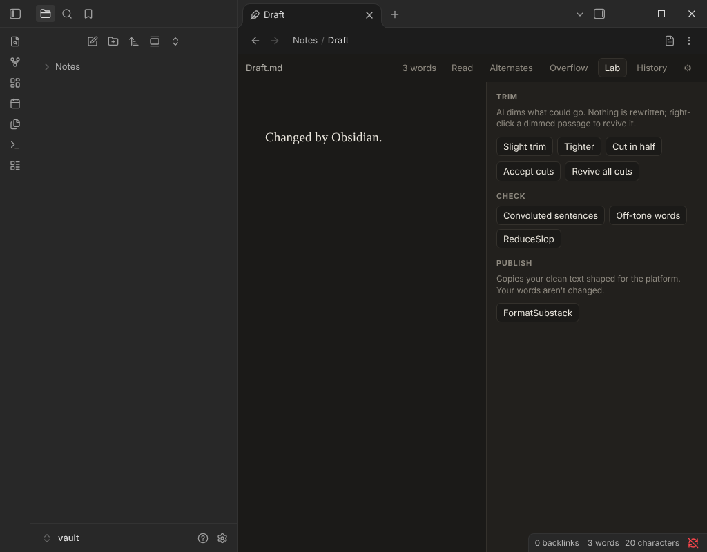

# Haashiya for Obsidian

Write an Obsidian note in [Haashiya](https://haashiya.reposhifu.com)'s editor, in an Obsidian tab: inline
alternates you try with ↑/↓, ghosted text, an overflow panel, version history, and a Lab where AI suggests or
dims but never rewrites you. The note stays a plain `.md` file in your vault.



Desktop only. Needs Obsidian 1.11.4 or later.

## Use

- Command palette: **Open current note in Haashiya** / **Open current note as Markdown**
- Right-click a note in the file list: **Open in Haashiya**
- In a Haashiya tab, the page icon at the top right goes back to Obsidian's editor.
- Haashiya's marks are plain text, so the note reads fine anywhere:
  `{{one|>two|three}}` holds alternates (`>` marks the chosen one), `~~text~~` is ghosted text.

## AI and network use

The Lab (trims, checks) and AI alternates send the note's text, or the selected passage, to the AI provider
you choose in Haashiya's settings (⚙︎ or ⌘,): Anthropic, OpenAI, Google Gemini, or any OpenAI-compatible server
such as OpenRouter or a local Ollama. You bring your own API key. Nothing is sent until you use an AI feature
and agree to a one-time permission prompt. The plugin makes no other network calls.

Your key is kept in Obsidian's secret storage (encrypted with your system keychain), not in the vault, and is
only ever sent to the provider it belongs to.

## Install

Until it is listed in Obsidian's community plugins: install [BRAT](https://github.com/TfTHacker/obsidian42-brat),
then *BRAT: Add a beta plugin* → `amitd01/obsidian-haashiya`. Or download `main.js`, `manifest.json` and
`styles.css` from the latest release into `<vault>/.obsidian/plugins/haashiya/` and enable **Haashiya** in
Settings ▸ Community plugins.

## How it works

Each tab holds Haashiya's editor (`editor/`) in its own frame. The plugin (`main.js`) hands it the note and
saves what it sends back; it keeps the API keys and makes the AI requests with Obsidian's `requestUrl`.
`build.sh` bundles everything into one `main.js` with esbuild.

```bash
bash build.sh        # → dist/main.js, dist/manifest.json, dist/styles.css
```

This repository is published from Haashiya's main (private) repository, where the tests live; issues and
suggestions are welcome here.

## Licence

GPL-3.0; see `LICENSE`. The names "Haashiya" and "Margin" and the Haashiya icon are not covered by
the licence: forks are welcome under another name.
